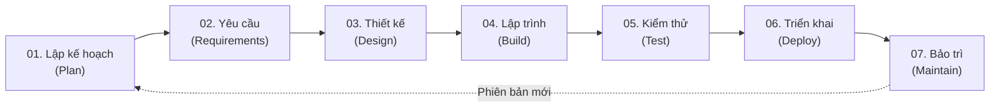
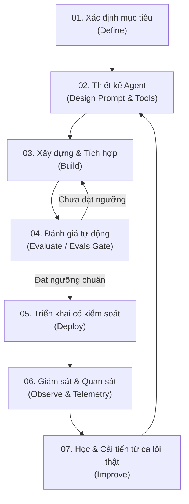
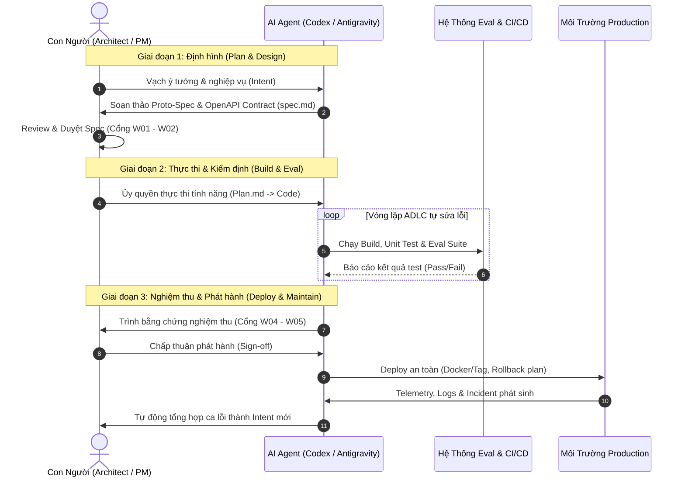

# Sơ Đồ Quy Trình: SDLC và ADLC — Phương Pháp Luận Vibe Coding Chuẩn

> **"Đừng Vibe Code nếu bạn không nắm rõ 2 quy trình này, nếu không sản phẩm của bạn chỉ là sản phẩm rác!"**  
> *Trích dẫn từ bài giảng Code Web Không Khó (Agent Hub).*

---

## 1. Giới Thiệu Tổng Quan

Trong kỷ nguyên phát triển phần mềm có AI hỗ trợ (Vibe Coding), việc chỉ gõ prompt tự do mà không có phương pháp luận sẽ dẫn đến sản phẩm thiếu ổn định, vỡ kiến trúc và không thể bảo trì.

Để giải quyết triệt để, chúng ta kết hợp hai mô hình:
1. **SDLC (Software Development Life Cycle)**: Vòng đời phần mềm truyền thống — Tuyến tính, có cổng kiểm soát chất lượng do con người làm chủ.
2. **ADLC (Agent Development Life Cycle)**: Vòng đời phát triển AI Agent — Vòng lặp liên tục, đo lường bằng bộ đánh giá tự động (Evals).

```
┌────────────────────────────────────────────────────────────────────────┐
│                      TRIẾT LÝ VIBE CODING CHUẨN                        │
│             "Con người định hình — AI Agent thực thi"                  │
│  SDLC lo phần định hướng và cổng nghiệm thu                            │
│  ADLC lo phần thực thi kỹ thuật và vòng lặp tối ưu                     │
└────────────────────────────────────────────────────────────────────────┘
```

---

## 2. Mô Hình 1: SDLC Truyền Thống (Software Development Life Cycle)



- **Đặc điểm**: Tuyến tính (Linear), một chiều. Mỗi pha phải hoàn thành và được phê duyệt trước khi chuyển sang pha sau.
- **Rủi ro**: Nếu phát hiện lỗi muộn ở pha Kiểm thử (Test) hoặc Triển khai (Deploy), chi phí sửa chữa là rất lớn.

---

## 3. Mô Hình 2: ADLC Hiện Đại (Agent Development Life Cycle)

AI Agent có đầu ra mang tính xác suất (probabilistic output). Do đó, chất lượng của Agent không đo bằng cảm tính mà đo bằng **bộ Eval tự động** và dữ liệu vận hành thực tế.



- **Đặc điểm**: Vòng lặp khép kín không dừng. Mỗi chu kỳ lặp giúp Agent ngày càng thông minh, chính xác và bám sát nghiệp vụ hơn.

---

## 4. Mô Hình Kết Hợp: SDLC + ADLC (Con Người Định Hình, Agent Thực Thi)

Đây là mô hình hoàn hảo nhất cho kỹ sư lập trình AI:



---

## 5. Bản Đồ Phân Vai 6 Giai Đoạn Chuẩn Hóa

| # | Giai đoạn | Vai trò Agent | Đầu ra (Artifact) | Nhiệm vụ chính |
|:---:|---|---|---|---|
| **1** | **Plan** (Lập kế hoạch) | `Project Manager Agent` | `intent.md` | Lắng nghe pain-point thực tế, viết proto-spec, xác định phạm vi. |
| **2** | **Design** (Thiết kế) | `Architect / UI-UX Designer` | `spec.md`, Design Tokens | Hợp nhất yêu cầu và thiết kế kỹ thuật, chốt schema & OpenAPI. |
| **3** | **Build** (Xây dựng) | `Software Engineer Agent` | `plan.md`, Source Code | Lập kế hoạch atomic steps trước khi gõ code, tuân thủ Clean Code. |
| **4** | **Test** (Kiểm thử) | `QA / Test Engineer Agent` | `evals`, CI Report | Viết test trước (TDD), chạy eval liên tục, tự vá lỗi phát sinh. |
| **5** | **Deploy** (Triển khai) | `DevOps / Release Engineer` | PR Review, Release Tag | Đóng gói Docker, kiểm tra migration, thiết lập rollback an toàn. |
| **6** | **Maintain** (Vận hành) | `SRE / Ops Engineer` | Metrics, `intent.md` mới | Giám sát telemetry, bắt lỗi runtime để khởi động vòng lặp mới. |

---

## 6. Ứng Dụng Thực Tiễn Vào Dự Án Net108Khai

Tại dự án **Net108Khai**, chúng ta đã triển khai nguyên vẹn quy trình này:
1. **Con người**: Đóng vai trò Chủ dự án, giữ quyền quyết định tại các cổng Waterfall `W01` (Yêu cầu), `W02` (Thiết kế), `W05` (Nghiệm thu UAT).
2. **AI Agents**:
   - **Antigravity**: Đóng vai trò Frontend Lead & UI Designer (`F01`–`F08`), hiện thực hóa giao diện React 19, Design Tokens và trải nghiệm mua sắm tiếng Việt.
   - **Codex**: Đóng vai trò Backend Lead & DevOps (`C00`, `C02`–`C18`), thiết kế DB PostgreSQL, OpenAPI v1, Transactional Outbox, và Docker Compose.
3. **Mỗi bước đều để lại Artifact**: Mã việc nhỏ được ghi nhận minh bạch tại `docs/01-tong-quan/AI-COMMERCE-TASK-BOARD.md` và đồng bộ tự động lên Jira Cloud.
