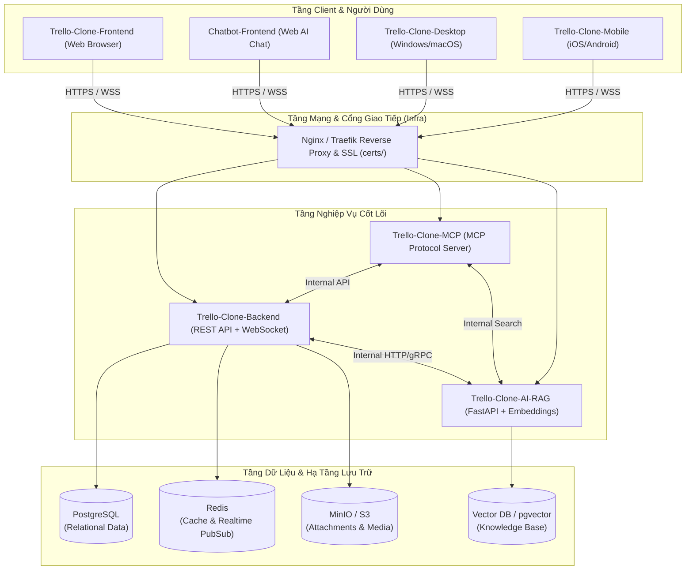

# Hệ Thống Kiến Trúc Net108Khai (System Architecture)

Tài liệu này mô tả kiến trúc tổng thể của hệ sinh thái **Net108Khai** – một nền tảng quản lý công việc theo mô hình Trello kết hợp trợ lý AI thông minh đa kênh.

---

## 1. Sơ Đồ Khối Toàn Hệ Thống

---

## 2. Phân Tách Trách Nhiệm Từng Module

### 2.1. `Trello-Clone-Backend`
- Quản lý định danh (Authentication: JWT, OAuth2) và phân quyền (RBAC: Workspace Owner, Board Admin, Member, Observer).
- Cung cấp CRUD API cho Workspaces, Boards, Lists, Cards, Labels, Checklists, Attachments, Comments.
- Đồng bộ thời gian thực (Real-time synchronization) qua WebSocket (Socket.io hoặc native WebSocket) khi có sự kiện kéo thả, thêm mới hoặc sửa thẻ.

### 2.2. `Trello-Clone-Frontend` & `Chatbot-Frontend`
- **`Trello-Clone-Frontend`**: Giao diện người dùng web tuân thủ triết lý **Apple Design**:
  - Tương tác kéo thả mượt mà với cảm biến phản hồi tức thì (`pointerdown`).
  - Lò xo vật lý (`spring physics`) cho danh sách và thẻ.
  - Tối ưu hóa render qua virtualization khi bảng có hàng ngàn thẻ.
- **`Chatbot-Frontend`**: Widget hoặc trang trò chuyện chuyên dụng:
  - Cho phép người dùng ra lệnh bằng tiếng Việt tự nhiên ("Tạo task sprint mới", "Tìm giúp tôi tài liệu thiết kế Dark Mode").
  - Giao tiếp thời gian thực qua WebSocket/SSE với `Trello-Clone-AI-RAG` và `Trello-Clone-MCP`.

### 2.3. `Trello-Clone-Desktop` & `Trello-Clone-Mobile`
- **Desktop**: Tích hợp phím tắt toàn cục (Global shortcuts), thông báo hệ thống native (System tray, Native notifications), hoạt động offline-first với cơ chế sync định kỳ.
- **Mobile**: Tối ưu cử chỉ chạm, vuốt để chuyển danh sách, haptic feedback khi kéo thả thẻ.

### 2.4. `Trello-Clone-AI-RAG`
- Dịch vụ AI chuyên biệt:
  - Ingestion Pipeline: Đọc và nhúng (embed) nội dung thẻ, comment, file đính kèm dạng Markdown/PDF.
  - Semantic Search: Tìm kiếm tài liệu, thẻ tương tự theo ngữ nghĩa thay vì chỉ khớp từ khóa chính xác.
  - Generative Features: Tự động phân loại thẻ, tạo tóm tắt họp hằng ngày (daily standup), phát hiện deadline trùng lặp.

### 2.5. `Trello-Clone-MCP`
- Cung cấp giao diện chuẩn hóa cho các AI Agent (Claude Code, Antigravity, Codex) đóng vai trò là "đồng nghiệp ảo" có khả năng chủ động truy vấn và thao tác trên bảng Trello theo ủy quyền của người dùng.

### 2.6. `Trello-Clone-Infra` & `certs/`
- Chứa toàn bộ cấu hình container hóa (`docker-compose.yml`, Dockerfile cho từng service).
- Quản lý cấu hình Reverse Proxy, giới hạn tài nguyên, mạng nội bộ (`internal-network`) ngăn lộ cơ sở dữ liệu ra ngoài Internet.
- Quản lý chứng chỉ bảo mật nội bộ tại thư mục `certs/`.
