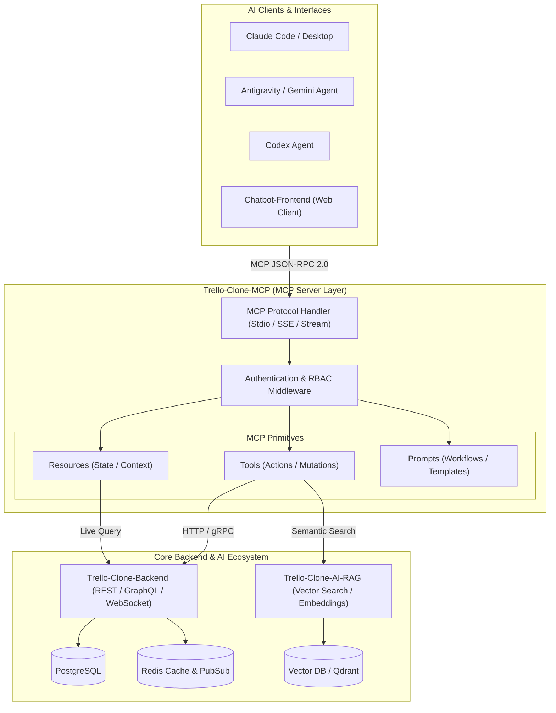
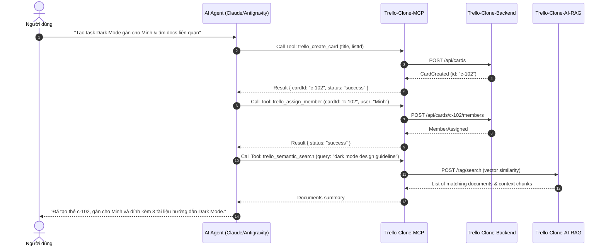

# MCP Reference Architecture (Model Context Protocol)

Tài liệu này xác lập kiến trúc tham chiếu cho dịch vụ **`Trello-Clone-MCP`** trong hệ sinh thái **Net108Khai**, cho phép các AI Agent (Claude, Codex, Antigravity, Custom Assistant) tương tác trực tiếp với dữ liệu bảng công việc (Boards, Lists, Cards) một cách an toàn, tiêu chuẩn hóa và mở rộng.

---

## 1. Tổng Quan Kiến Trúc (Architecture Overview)

Dịch vụ MCP hoạt động như một **lớp cầu nối chuẩn hóa (Standardized AI Gateway)** nằm giữa các AI Client (Agents) và hệ thống backend cốt lõi của Trello Clone cùng dịch vụ AI-RAG.

---

## 2. Ba Thành Phần Cơ Bản Của MCP (Core Primitives)

### 2.1. MCP Tools (Hành Động & Biến Đổi Dữ Liệu)
Các công cụ được Agent gọi để thực hiện thao tác nghiệp vụ, có kiểm tra kiểu dữ liệu thông qua JSON Schema:

| Tool Name | Mô Tả | Tham Số Đầu Vào (Input Schema) |
|---|---|---|
| `trello_create_card` | Tạo thẻ mới trên danh sách cụ thể | `{ listId: string, title: string, description?: string, dueDate?: string, labels?: string[] }` |
| `trello_move_card` | Di chuyển thẻ sang danh sách hoặc vị trí mới | `{ cardId: string, targetListId: string, position: number }` |
| `trello_update_card` | Cập nhật thông tin chi tiết của thẻ | `{ cardId: string, title?: string, description?: string, status?: string }` |
| `trello_add_comment` | Đăng bình luận hoặc cập nhật tiến độ | `{ cardId: string, content: string }` |
| `trello_assign_member` | Gán thành viên phụ trách thẻ | `{ cardId: string, userId: string }` |
| `trello_semantic_search` | Tìm kiếm thẻ thông minh qua ngữ nghĩa (RAG) | `{ query: string, boardId?: string, topK?: number }` |

### 2.2. MCP Resources (Tài Nguyên Dữ Liệu Theo URI)
Cung cấp ngữ cảnh (Context) trực tiếp cho Agent đọc mà không cần gọi API phức tạp:

| Resource URI Scheme | Loại Dữ Liệu Trả Về | Ứng Dụng Cho Agent |
|---|---|---|
| `trello://boards/{boardId}` | Toàn bộ cấu trúc bảng (Lists & Cards) | Cho phép Agent nắm toàn cảnh sprint hiện tại |
| `trello://cards/{cardId}` | Chi tiết thẻ, lịch sử hoạt động, checklists | Agent phân tích sâu nội dung và yêu cầu của thẻ |
| `trello://users/{userId}/assigned` | Danh sách các thẻ được gán cho 1 user | Hỗ trợ lập kế hoạch công việc cá nhân |
| `trello://activity/recent?limit=20` | Nhật ký hoạt động gần nhất trên bảng | Agent theo dõi thay đổi và phát hiện xung đột |

### 2.3. MCP Prompts (Mẫu Quy Trình Tương Tác Chuẩn)
Các kịch bản prompt đóng gói sẵn giúp Agent giải quyết công việc phức tạp:

- **`daily_standup_summary`**: Tổng hợp các thẻ vừa hoàn thành hôm qua, thẻ đang làm hôm nay và các blocker tồn đọng.
- **`sprint_planning_assistant`**: Phân tích backlog, ước lượng độ phức tạp và đề xuất phân bổ thẻ vào sprint mới.
- **`card_refinement_helper`**: Phân rã một yêu cầu lớn trên thẻ thành checklist các atomic tasks kèm tiêu chí nghiệm thu (acceptance criteria).

---

## 3. Luồng Tương Tác Điển Hình (Sequence Diagram)

Ví dụ: Người dùng yêu cầu Agent *"Tạo một task 'Thiết kế giao diện Dark Mode' và gán cho Minh, sau đó tìm các tài liệu liên quan trong kho RAG"*:

---

## 4. Bảo Mật & Kiểm Soát Quyền (Security & Governance)

1. **Xác Thực (Authentication)**:
   - Các kết nối qua Stdio sử dụng biến môi trường token cục bộ (`TRELLO_MCP_API_KEY`).
   - Kết nối qua SSE (Server-Sent Events) dùng Bearer JWT Token được cấp phát bởi `Trello-Clone-Backend`.
2. **Phân Quyền (RBAC)**:
   - Agent kế thừa quyền hạn của người dùng đang ủy quyền (User Impersonation). Agent không thể sửa hoặc xóa bảng/thẻ nếu user không có quyền tương ứng.
3. **Audit Log**:
   - Mọi Tool invocation của Agent đều được ghi nhận vào nhật ký hệ thống (`[AGENT_ACTION] tool=trello_create_card user=uid timestamp=...`), đảm bảo truy xuất nguồn gốc minh bạch.
4. **Giới Hạn Tần Suất (Rate Limiting)**:
   - Ngăn chặn tình trạng vòng lặp vô tận (infinite tool loop) bằng cách giới hạn tối đa 30 tool calls/phút trên mỗi phiên làm việc.
