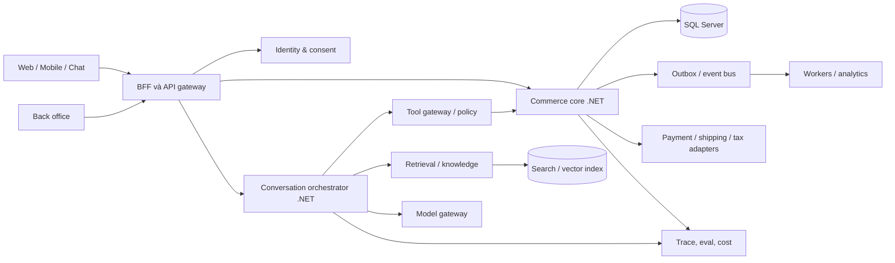

# Đặc tả hệ thống AI native Commerce — Net108Khai

Phiên bản 0.1, ngày 09/11/2026. Tài liệu này là **kiến trúc mục tiêu**, kèm đối chiếu với bản API chạy được trong repo. Các quy tắc thương mại chưa được Net108Khai cung cấp được đánh dấu **cần chốt**.

## 1. Mục tiêu và giả định

Net108Khai được giả định là doanh nghiệp bán hàng tại Việt Nam, phục vụ web/mobile và có nhân viên vận hành. Hệ thống lấy dữ liệu giao dịch làm nguồn sự thật; AI tham gia xuyên suốt khám phá, tư vấn, hỗ trợ và vận hành nhưng mọi thay đổi có tác động đều đi qua API nghiệp vụ. Đơn vị tiền mặc định là VND; hỗ trợ đa tiền tệ là khả năng mở rộng, chưa mặc định triển khai. Mỗi đơn thuộc một người bán; mô hình marketplace và nhiều nhà bán là **cần chốt**.

Mục tiêu kinh doanh cần đo: tăng tỷ lệ tìm được sản phẩm phù hợp, tỷ lệ thêm giỏ, tỷ lệ hoàn tất đơn, giá trị đơn và chất lượng hỗ trợ; đồng thời kiểm soát hoàn trả, chi phí AI và sai lệch thông tin. Các chỉ số có baseline trước khi đặt chỉ tiêu tuyệt đối.

**Ranh giới bản chạy đầu tiên:** chỉ có catalog mẫu, giỏ hàng, tạo đơn `pending_payment` và hỏi đáp catalog qua provider AI cấu hình ngoài. Chưa có đăng nhập, thanh toán, vận chuyển, quản trị, RAG hay agent ghi dữ liệu. Không dùng bản này cho giao dịch thật.

### Định hướng danh mục và góc đọc (quyết định phạm vi ngày 10/11/2026)

Net108Khai tập trung vào **đồ dùng học tập và sách giấy**, đồng thời có khu **đọc mẫu miễn phí và nghe nhạc khi đọc**. Danh mục dự kiến gồm văn phòng phẩm, phụ kiện góc học tập và sách giấy. AI tư vấn theo môn học, mục tiêu, độ tuổi và ngân sách; gợi ý sản phẩm hoặc bộ sách có trong catalog, kèm giá/tồn thực tế, không tự tạo tên sách, nội dung hay cam kết hiệu quả học tập.

Tham khảo [KhoaVerse](https://khoaverse.fun/) cho trải nghiệm đọc và nhạc nền; không sao chép nội dung, dữ liệu hoặc coi website tham khảo là giấy phép khai thác thương mại. **Phạm vi bản đầu:** sách giấy đi qua tồn kho, vận chuyển và hoàn hàng; trang đọc mẫu chỉ hiển thị đoạn được phép công bố; trình phát nhạc dùng tệp người dùng tự chọn từ thiết bị. Không bán ebook toàn văn hoặc phát thư viện nhạc từ máy chủ trong bản đầu. Các khả năng này chỉ được đưa vào bản sau khi chốt quyền nội dung và thiết kế quyền truy cập số. Quyền công bố từng đoạn đọc mẫu, danh mục SKU, người bán và kho vẫn cần chốt trong `C01.1/W01`; quyết định phạm vi này chưa đóng toàn bộ cổng Waterfall.

**Luồng hai không gian:** vào `/` thấy cửa hàng Commerce với danh mục đồ học tập, sách, tìm kiếm, giỏ và trợ lý AI. Thanh điều hướng có mục **Đọc sách online** dẫn tới `/read`; trên thẻ/trang chi tiết sách có **Xem sách** dẫn tới `/read/{slug}` nếu sách có bản đọc mẫu được xuất bản. `/read` là thư viện truyện/sách mẫu; `/read/{slug}` mở trải nghiệm đọc riêng, có đường quay về cửa hàng và đường xem/mua sách giấy tương ứng. Nút xem sách không được dẫn tới trang trắng hoặc văn bản mẫu tự bịa khi chưa có nội dung được duyệt.

**Trải nghiệm đọc tham chiếu KhoaVerse:** khu chọn sách có tìm kiếm và thẻ sách; khi mở sách có trang bìa/mở đầu, mục lục chương, vùng chữ đọc tập trung, nút trang trước/sau, điều chỉnh giao diện đọc và nhạc nền. Nhạc MP3 do người dùng chọn từ máy chỉ phát trong phiên trình duyệt, có phát/tạm dừng/chuyển bài và không tải tệp lên máy chủ. Thiết kế frontend cần đối chiếu trực tiếp bố cục, chuyển động và trạng thái mobile/desktop của trang tham chiếu tại `W02`, nhưng dùng nhận diện Net108Khai và nội dung có quyền công bố. Tiêu chí nghiệm thu là luồng và trải nghiệm tương đương; yêu cầu giống từng pixel chỉ có thể xác nhận bằng so sánh ảnh trên cùng viewport sau khi có bản thiết kế và dữ liệu hợp lệ.

**Dữ liệu và quyền:** mỗi sách giấy có thể liên kết tối đa một bản đọc mẫu đã duyệt gồm tiêu đề, tác giả, bìa, thứ tự chương/đoạn, nguồn và trạng thái xuất bản. API công khai chỉ trả phần được phép xem; bản nháp hoặc bị thu hồi trả `404`, không lộ đường dẫn tệp gốc. Nội dung đọc mẫu được nhập/quản trị bởi nhân viên có quyền, ghi nguồn/quyền công bố và thời điểm duyệt. AI chỉ mô tả sách từ metadata và nội dung được phép dùng; không sinh thêm chương hoặc trích toàn văn ngoài bản đọc mẫu. Hợp đồng API và schema Code First được chốt tại `W02` trước khi Codex triển khai và Antigravity nối UI.

## 2. Nguyên tắc hệ thống

1. Giá, tồn, khuyến mại, phí và trạng thái đơn lấy từ dịch vụ nghiệp vụ tại thời điểm quyết định; không lấy từ văn bản AI sinh ra hoặc vector index.
2. Mô hình chỉ tạo đề xuất, ý định và câu trả lời. Tool gateway kiểm tra danh tính, quyền, giới hạn và xác nhận; domain service thực thi.
3. Các hành động ghi có `idempotency key`, nhật ký và kết quả có thể truy vết. Thanh toán/hoàn tiền/đổi địa chỉ sau khi đặt hàng cần xác nhận cụ thể.
4. Nội dung nguồn ngoài, sản phẩm và hội thoại là dữ liệu không tin cậy; không được sửa system policy hay quyền tool.
5. Tách dữ liệu cá nhân khỏi dữ liệu phục vụ tìm kiếm khi có thể; tối thiểu hóa nội dung đưa tới model.
6. Thiết kế theo bounded context; triển khai ban đầu dưới dạng modular monolith .NET, chỉ tách service khi có nhu cầu vận hành rõ.

## 3. Kênh và vai trò

| Vai trò | Quyền chính | Kênh |
| --- | --- | --- |
| Khách vãng lai | Xem/tìm sản phẩm, tạo giỏ tạm, hỏi trợ lý | Web/mobile/chat |
| Khách đã xác thực | Quản lý hồ sơ, địa chỉ, đơn của mình, yêu cầu hỗ trợ | Web/mobile |
| Nhân viên CS | Xem dữ liệu được phân quyền, xử lý handoff và yêu cầu sau bán | Back office |
| Merchandiser | Quản lý catalog, nội dung, giá và chương trình khuyến mại | Back office |
| Nhân viên kho | Xác nhận nhận hàng, đóng gói, xuất kho, hoàn nhập | Back office |
| Quản trị hệ thống | Cấu hình kênh, chính sách quyền và tích hợp; không mặc định được xem PII | Back office |
| AI assistant | Quyền tool giới hạn theo người dùng/kịch bản, không có tài khoản đặc quyền chung | Các kênh |

## 4. Kiến trúc logic

**Các module .NET mục tiêu:** `Identity`, `Catalog`, `Pricing`, `Inventory`, `Cart`, `Checkout`, `Orders`, `Payments`, `Fulfillment`, `Returns`, `Customer`, `Promotions`, `Knowledge`, `Conversations`, `AgentTools`, `Notifications`, `Analytics`. BFF cung cấp contract theo kênh. Worker tiêu thụ outbox và chạy đồng bộ/tái lập chỉ mục. `Infrastructure` chứa database, provider, queue và các adapter. Lớp domain không gọi model trực tiếp.

**Triển khai:** ASP.NET Core 10 cho API/BFF/orchestrator; SQL Server làm transactional store từ Lab 3; Redis cho cache và khóa ngắn hạn khi cần; object storage cho ảnh/tài liệu; search index cho tìm kiếm văn bản; vector index cho tri thức đã duyệt; broker khi outbox cần fan-out. Docker Compose dành cho phát triển; môi trường thật cần secret manager, ingress/TLS, backup và rolling deployment. Chỉ thêm thành phần khi module sử dụng nó.

## 5. Bounded context và quyền sở hữu dữ liệu

| Context | Trách nhiệm / dữ liệu gốc | Quy tắc bất biến |
| --- | --- | --- |
| Identity & Consent | User, role, session, consent, tenant | Chỉ chủ sở hữu hoặc role được ủy quyền truy cập PII |
| Catalog | Product, Variant, category, media, thuộc tính, trạng thái xuất bản | SKU duy nhất trong phạm vi người bán; không bán biến thể chưa xuất bản |
| Pricing & Promotion | Offer, price list, coupon, rule, hiệu lực | Tính giá ở server; lưu bản chụp giá trên đơn |
| Inventory | Stock ledger, reservation, kho | Tồn không âm; giữ hàng có hạn và được giải phóng rõ ràng |
| Cart & Checkout | Cart, quote, địa chỉ giao/nhận, lựa chọn vận chuyển | Quote có hạn; checkout tính lại tất cả điều kiện |
| Orders | Order, order line, chuyển trạng thái | Đơn có ID ổn định; thay đổi bằng transition hợp lệ |
| Payments | Payment intent, capture, refund, webhook | Xử lý webhook lặp an toàn; tổng hoàn không vượt số đã thu |
| Fulfillment & Returns | Shipment, tracking, return request | Số lượng giao/hoàn không vượt số lượng trên đơn |
| Customer & Support | Hồ sơ, ticket, handoff | CS chỉ thấy thông tin cần xử lý ticket |
| Knowledge | Policy document, version, chunk, source | Chỉ nội dung đã duyệt được đưa vào retrieval phục vụ khách |
| Conversations & AgentTools | Conversation, turn, tool call, confirmation | Model không tự cấp quyền; mọi write qua policy gateway |
| Analytics | Sự kiện, funnel, chỉ số, báo cáo | Không dùng analytics làm nguồn sự thật giao dịch |

Tham chiếu chéo dùng ID và sự kiện, tránh join trực tiếp giữa các module khi tách service. Cần chốt: nhiều kho, hàng số, đơn đặt trước, biến thể, B2B, thuế và quy tắc hóa đơn.

## 6. Luồng nghiệp vụ và trạng thái

### 6.1 Khám phá đến đặt hàng

1. Khách tìm bằng từ khóa/thuộc tính hoặc hội thoại. Search trả ID; Catalog/Pricing/Inventory trả dữ liệu có hiệu lực.
2. Trợ lý giải thích lựa chọn kèm SKU/nguồn. So sánh phải dựa trên thuộc tính có thật; khi không đủ dữ liệu, nêu thiếu sót.
3. Khách thêm biến thể vào giỏ. Giỏ không giữ tồn lâu dài. UI hiển thị giá ước tính và lần cập nhật.
4. Checkout tạo quote từ giá, coupon, thuế, phí giao và tồn. Khách xác nhận tổng tiền, địa chỉ và điều kiện.
5. Hệ thống tạo đơn và giữ hàng trong transaction/saga; tạo payment intent. Kết quả có thể ở `pending_payment`.
6. Webhook thanh toán xác minh chữ ký, lưu sự kiện, xử lý idempotent; chuyển đơn sang `paid` và kích hoạt fulfillment.
7. Quá hạn thanh toán: hủy payment intent, giải phóng reservation và chuyển đơn sang `expired`.

**Order state:** `pending_payment → paid → fulfilling → shipped → delivered → completed`. Từ `pending_payment` có thể `cancelled`/`expired`; từ `paid` có thể `cancel_requested` và hoàn tiền theo chính sách. `returned` là trạng thái của return case, không ghi đè lịch sử đơn. Mọi transition ghi actor, lý do và timestamp.

**Payment state:** `created → requires_action → authorized → captured`; nhánh `failed`, `cancelled`, `partially_refunded`, `refunded`. **Reservation state:** `active → consumed | released | expired`. Thiết kế cho thanh toán giao sau/COD là **cần chốt**.

### 6.2 Trợ lý mua sắm

Input gồm câu hỏi, kênh, locale, user/tenant, consent và context tối thiểu. Orchestrator phân loại mục đích, tìm nguồn, gọi tool đọc dữ liệu tươi, sinh câu trả lời, kiểm tra đầu ra rồi lưu trace. Câu trả lời về giá/tồn nêu thời điểm dữ liệu; chính sách nêu tài liệu và phiên bản. Khi người dùng yêu cầu thao tác ghi, trợ lý tạo preview gồm mục tiêu và tác động; chỉ sau xác nhận rõ mới gọi tool. Nếu thiếu chứng cứ, quyền hoặc model lỗi, trợ lý báo giới hạn và handoff.

| Tool | Quyền | Dữ liệu/trạng thái yêu cầu |
| --- | --- | --- |
| `search_products` | Đọc công khai | Bộ lọc đã xác thực, giới hạn kết quả |
| `get_product_offer` | Đọc công khai | SKU/kênh; giá và tồn thời gian thực |
| `get_order_status` | Đọc riêng | User đã xác thực và là chủ đơn hoặc CS được cấp quyền |
| `add_cart_item` | Ghi giỏ | Cart thuộc session, số lượng hợp lệ; có thể hoàn tác |
| `prepare_checkout` | Tạo preview | Quote có hạn, không đặt đơn |
| `place_order` | Ghi đơn | User xác thực, confirmation token, idempotency key |
| `request_return` | Ghi yêu cầu | Đơn hợp lệ, chính sách và confirmation |
| `handoff_to_human` | Ghi ticket | Consent chuyển transcript và thông tin cần thiết |

Tool gateway kiểm schema, ACL theo object, rate limit, budget, confirmation token gắn hash payload/TTL, và ghi audit. Prompt không phải lớp bảo vệ duy nhất. Không để model tự gọi SQL, HTTP tùy ý, email hay payment provider.

### 6.3 Knowledge và RAG

Nguồn: chính sách, FAQ, hướng dẫn, thuộc tính catalog và nội dung chăm sóc khách. Pipeline `ingest → kiểm virus/định dạng → phân loại PII/quyền → duyệt → chia đoạn → embedding → index → canary → xuất bản`. Mỗi đoạn có `source_id`, version, effective dates, locale, tenant và ACL. Retrieval kết hợp keyword + semantic, lọc quyền trước khi xếp hạng; trả đoạn trích và URI nguồn. Khi tài liệu bị thu hồi, xóa khỏi index và vô hiệu cache. Giá/tồn/đơn không đưa vào RAG làm nguồn sự thật.

### 6.4 Vận hành AI

Các tác vụ gợi ý: chuẩn hóa thuộc tính catalog, phát hiện trùng SKU, viết mô tả nháp, phân loại ticket, tóm tắt handoff, dự báo nhu cầu, gợi ý bổ sung tồn. Mọi nội dung xuất bản và thay đổi giá cần người phụ trách duyệt. Dự báo chỉ là tín hiệu cho quyết định nhập hàng.

## 7. Hợp đồng API và sự kiện mục tiêu

API versioned `/api/v1`. Các thao tác ghi nhận `Idempotency-Key`; lỗi theo Problem Details với `traceId`, mã lỗi ổn định và thông điệp an toàn. Phân trang cursor cho list lớn; tiền dùng số nguyên minor unit và mã tiền; thời gian ISO 8601 UTC. API công khai có rate limit và OAuth/OIDC hoặc session cookie an toàn. Tài nguyên riêng kiểm quyền theo object.

| API | Chức năng |
| --- | --- |
| `GET /products`, `GET /products/{id}` | Catalog/search/filter |
| `POST /carts`, `PUT /carts/{id}/items/{sku}`, `GET /carts/{id}` | Giỏ |
| `POST /checkouts/quotes`, `POST /orders` | Tính lại và đặt đơn |
| `GET /orders/{id}`, `POST /orders/{id}/cancel` | Theo dõi và yêu cầu hủy |
| `POST /payments/webhooks/{provider}` | Sự kiện provider đã xác thực |
| `POST /conversations`, `POST /conversations/{id}/turns` | Hội thoại |
| `POST /agent-actions/{id}/confirm` | Xác nhận hành động |
| `POST /returns`, `GET /returns/{id}` | Sau bán |

Sự kiện nội bộ: `ProductPublished`, `OfferChanged`, `StockChanged`, `CartAbandoned`, `OrderPlaced`, `PaymentCaptured`, `PaymentFailed`, `ReservationExpired`, `ShipmentDispatched`, `ReturnRequested`, `RefundCompleted`, `ConversationHandedOff`. Event envelope có `eventId`, `type`, `version`, `occurredAt`, `tenantId`, `aggregateId`, `correlationId`, `causationId` và payload. Outbox nằm cùng transaction với state; consumer lưu inbox/dedup. Thay đổi schema có version và khả năng xử lý dữ liệu cũ.

## 8. Dữ liệu và tích hợp

Transactional SQL Server: bảng theo module với khóa chính `uniqueidentifier`, thời gian `datetimeoffset`, ràng buộc DB, index theo truy vấn, audit trail và outbox. Ảnh/tài liệu trong object storage, metadata/ACL trong DB. Search/vector là projection có thể tái tạo. Redis chỉ cache và rate limit, không là nguồn sự thật. Backup theo mục tiêu RPO/RTO được chủ dự án duyệt; thử phục hồi định kỳ.

Adapter tách payment, shipping, tax/invoice, CRM, email/SMS và kênh chat. Mỗi adapter có timeout, retry hữu hạn với jitter, circuit breaker, mapping lỗi và reconciliation định kỳ. Webhook yêu cầu chữ ký, timestamp chống replay và inbox idempotent. Không lưu dữ liệu thẻ; dùng trang/token của provider. Các provider cụ thể và yêu cầu pháp lý là **cần chốt**.

## 9. Bảo mật, riêng tư và an toàn AI

- HTTPS/TLS; bí mật trong secret manager, rotate được; không commit API key. DB và object storage mã hóa theo chính sách hạ tầng.
- RBAC + kiểm chủ sở hữu theo object; quyền tool kế thừa quyền người dùng; thao tác nhạy cảm cần step-up/confirmation.
- Tối thiểu hóa PII trong prompt và log; transcript có chính sách retention/xóa, quyền truy cập và consent theo kênh.
- Kiểm prompt injection bằng phân tách instruction/data, tool allowlist, validation tại gateway và kiểm chứng đầu ra. Sản phẩm/tài liệu không được tạo lệnh hệ thống.
- Giới hạn chi phí/độ trễ theo tenant, user và tác vụ; timeout, fallback tìm kiếm thường, handoff. Model/provider có thể thay thế qua gateway.
- Audit gồm ai, làm gì, trên object nào, kết quả, model/prompt/tool version và trace; che dữ liệu nhạy cảm.
- Không tự động xuất bản nội dung AI, thay đổi giá, hoàn tiền hoặc đặt đơn khi chưa có điều kiện/duyệt nêu trên.

## 10. Quan sát, chất lượng và SLO đề xuất

Trace xuyên kênh → API → tool → provider → DB với `correlationId`. Metrics: p50/p95/p99 latency, error rate, checkout success, payment reconciliation, tồn âm, outbox lag, cache hit, model tokens/cost, tool deny, handoff rate, grounded answer rate, citation coverage, conversion funnel. Log JSON có phân loại PII và sampling. Dashboard tách kinh doanh, vận hành và chất lượng AI.

**SLO khởi điểm để xác nhận sau đo tải:** API catalog/giỏ p95 < 500 ms tại tải mục tiêu; checkout p95 < 1 s không tính redirect provider; uptime 99.9% cho API giao dịch; 0 trường hợp bán vượt tồn; 100% write tool có audit; ≥ 99.9% webhook xử lý hoặc đưa vào hàng xử lý lại. AI response p95 và ngân sách token cần đo theo provider trước khi cam kết.

Đánh giá AI theo tập câu hỏi tiếng Việt gồm giá/tồn thay đổi, so sánh sản phẩm, chính sách mâu thuẫn, thiếu dữ liệu, prompt injection, truy cập đơn người khác và xác nhận thao tác. Gate phát hành: không rò PII, không tool trái quyền, không khẳng định đặt đơn khi chưa có order ID, tỷ lệ câu trả lời có căn cứ đạt ngưỡng do chủ sản phẩm duyệt. Chạy canary/rollback prompt và model độc lập với release API.

## 11. Nhóm chức năng và nghiệm thu

**Quy trình dự án là [Waterfall `W01–W06`](AI-COMMERCE-WATERFALL.md).** Các đợt dưới đây chỉ nhóm phạm vi chức năng để lập kế hoạch trong giai đoạn triển khai; chúng không phải thứ tự duyệt giai đoạn. Baseline đã có phải được đối chiếu với yêu cầu và thiết kế trước khi nghiệm thu.

| Giai đoạn | Kết quả có thể nghiệm thu |
| --- | --- |
| 0. Khung chạy được | Compose khởi động, health, catalog mẫu, giỏ, checkout idempotent, hỏi đáp catalog khi có provider |
| 1. Commerce core | Auth, catalog/variant, pricing, inventory ledger/reservation, quote/order, migrations, admin, integration tests |
| 2. Giao dịch thật | Payment/shipping adapters, webhook, reconciliation, returns, notifications, audit, backup/restore |
| 3. AI native | Conversation, retrieval có ACL, tool gateway, confirmation, handoff, eval/trace/cost, rollout guardrails |
| 4. Tối ưu | Cá nhân hóa có consent, dự báo, A/B, đa kênh và scale theo tải |

**Kiểm tra trong triển khai, nghiệm thu hệ thống tại `W04`:** unit tests cho bất biến được chạy cùng code; integration tests SQL Server và adapter giả, contract tests cho webhook, concurrency tests checkout/tồn, end-to-end từ tìm → trả tiền → giao/hoàn, load test theo traffic thực, security review và restore drill là bằng chứng của cổng kiểm thử. Khi đổi yêu cầu/thiết kế, áp dụng kiểm soát thay đổi trước khi tiếp tục.

## 12. Đối chiếu bản hiện có

| Mục | Trong repo hiện tại |
| --- | --- |
| .NET API, SQL Server, Docker Compose | Có cấu hình và build; Compose dev chạy migrator trước API theo thiết kế, chưa kiểm thử container trên máy hiện tại |
| EF Core code first và migration versioned | Có migration SQL Server mới cho schema `commerce`, tạo script T-SQL idempotent được; chưa thử áp dụng trên SQL Server thật |
| Catalog và biến thể | Có model và API đọc/quản trị cơ bản; chưa có offer/khuyến mại hoặc media |
| Identity bearer, mã email, đặt lại mật khẩu, OAuth Google/Facebook, RBAC và kiểm quyền giỏ/đơn | Có code và hợp đồng trong `BACKEND-AUTH.md`; OAuth chỉ bật khi cấu hình credential, chưa kiểm thử tích hợp với DB/SMTP/provider thật |
| Giỏ và checkout tạo đơn `pending_payment` | Có code; khóa transaction, trừ tồn và ghi movement, idempotency; chưa kiểm thử đồng thời trên DB thật |
| Đơn hết hạn/hủy | Có worker hết hạn 30 phút và API hủy/hoàn tồn; chưa kiểm thử tích hợp |
| AI chọn SKU | Có khi cấu hình provider; server lấy giá/tồn từ DB, giới hạn 200 biến thể; chưa kiểm thử provider thật |
| Pricing engine, payment, shipping, tenant | Chưa; payment được chủ dự án yêu cầu tích hợp cuối |
| RAG, tool gateway, confirmation, handoff, eval | Chưa |
| Admin UI, observability, production hardening | Chưa; backend đã có khóa Data Protection bền vững/mã hóa theo cấu hình, rate limit và lockout, nhưng chưa nghiệm thu bảo mật production |

Các thư mục `Trello-Clone-*` và `Chatbot-Frontend` là khung trống khi bắt đầu; không có logic cũ để tích hợp. Backend dùng EF Core migration SQL Server trong schema `commerce`, không tự thay CSDL lúc API khởi động. Dữ liệu mẫu chỉ được thêm qua migrator ở Development. Trước khi dùng giao dịch thật cần kiểm thử trên SQL Server, xác minh auth/stock concurrency, chốt giá/thuế/vận chuyển và tích hợp thanh toán. Xem [quyết định chuyển provider](../02-ky-thuat/SQLSERVER-TRANSITION-LAB3.md) để xử lý dữ liệu PostgreSQL cũ.

## 13. Quyết định cần chủ dự án chốt

1. Net108Khai bán loại hàng nào, có biến thể/hàng số/đặt trước không; một hay nhiều người bán/kho?
2. Kênh ưu tiên, lưu lượng dự kiến, khu vực giao hàng, ngôn ngữ và mức cá nhân hóa được khách đồng ý?
3. Phương thức thanh toán, COD, nhà vận chuyển, thuế/hóa đơn và chính sách hoàn/đổi?
4. Provider/model AI được phép dùng, vị trí xử lý dữ liệu, giới hạn chi phí và yêu cầu lưu/xóa transcript?
5. Mục tiêu tải, SLO, RPO/RTO và hệ thống quản trị hiện có cần tích hợp?

Các câu trả lời này sẽ thay đổi hợp đồng API và mô hình dữ liệu của giai đoạn 1–3; bản demo giai đoạn 0 vẫn chạy độc lập.
